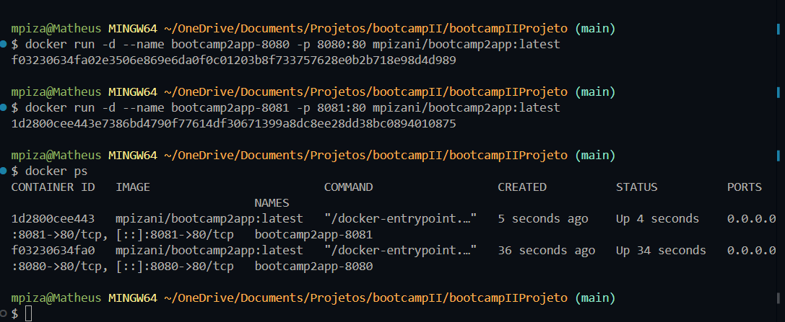

# Autor
Matheus Pizani de Albuquerque - 22309128

# Descrição
Aplicação web que permite buscar pratos por nome e visualizar categoria,
origem, ingredientes com medidas e modo de preparo, consumindo dados em
tempo real de uma API pública de receitas. Também é possível sortear um
prato aleatório.

# API utilizada
- **Nome:** TheMealDB API (chave pública de teste `1`, sem cadastro)
- **Documentação:** https://www.themealdb.com/api.php
- **Endpoints consumidos:**
  - `GET https://www.themealdb.com/api/json/v1/1/search.php?s={termo}` — busca pratos por nome
  - `GET https://www.themealdb.com/api/json/v1/1/random.php` — sorteia um prato aleatório

# Funcionalidades
- Busca de pratos por nome ou ingrediente
- Lista de resultados clicável, com troca de receita em destaque sem nova requisição
- Exibição de categoria, origem, lista de ingredientes com medidas, modo de preparo e link para vídeo no YouTube (quando disponível)
- Botão "Aleatório" para sortear um prato ao acaso
- Cadastro de novos usuários com Supabase Auth
- Login e logout com controle de sessão
- Redirecionamento entre as telas de autenticação e aplicação conforme o estado da sessão
- Adição e remoção de receitas favoritas
- Listagem de favoritos do usuário autenticado
- Persistência dos favoritos no Supabase/PostgreSQL
- Isolamento dos favoritos por usuário com filtros de usuário e políticas RLS
- Interface responsiva e mensagens de status para carregamento, erros e operações de autenticação
- Dockerização da aplicação com Nginx
- Execução local da aplicação por meio de container Docker
- Publicação de imagens no Docker Hub com as tags `1.0`, `1.1` e `latest`
- Execução simultânea de múltiplos containers em portas diferentes
- Tratamento de erros no frontend (mensagens amigáveis) quando acontece algum problema na requisição

# Autenticação
A tela de cadastro e login utiliza o Supabase Auth por meio da chave pública
configurada no frontend. A confirmação de e-mail, caso esteja habilitada no
projeto Supabase, é solicitada após o cadastro. A sessão autenticada permite
adicionar, consultar e remover favoritos associados ao usuário.

# Como executar localmente
1. Clone o repositório: `git clone https://github.com/mpizanii/bootcampIIProjeto.git`
2. Abra o projeto com a extensão Live Server do VS Code.
3. A página inicial (`index.html`) redireciona para `auth.html`, a tela de login e cadastro.
4. Após autenticar, o usuário é encaminhado para `app.html`, onde está o buscador.

## Links do projeto

- **Repositório GitHub:** https://github.com/mpizanii/bootcampIIProjeto
- **Aplicação publicada:** https://mpizanii.github.io/bootcampIIProjeto/
- **Imagem no Docker Hub:** https://hub.docker.com/r/mpizani/bootcamp2app

## Executar com Docker

```bash
docker run -d --name bootcamp2app -p 8080:80 mpizani/bootcamp2app:latest
```

Depois, acesse http://localhost:8080. As tags disponíveis no Docker Hub são
`1.0`, `1.1` e `latest`.

## Persistência de dados

A persistência utiliza o **Supabase (PostgreSQL)**. A tabela `favorites` armazena
os favoritos de cada usuário autenticado, com os campos `id`, `user_id`,
`meal_id`, `meal_name`, `meal_thumb` e `created_at`. São salvos o identificador
do usuário, o identificador e o nome da receita e a URL da imagem, além da data
de criação do registro. O frontend consulta, insere e remove esses registros
por meio da API do Supabase; a aplicação não mantém esses dados dentro do
container, portanto eles continuam disponíveis mesmo quando os containers são
recriados. O acesso deve ser protegido por RLS, permitindo que cada usuário
consulte e altere somente os próprios favoritos. Senhas não são armazenadas
pela aplicação: a autenticação é gerenciada pelo Supabase Auth.

## `.dockerignore`

O arquivo `.dockerignore` impede que arquivos desnecessários, como `.git`,
`README.md`, `node_modules`, arquivos de log, configurações locais e rascunhos,
sejam enviados para o Docker durante o build.

Isso deixa o processo mais rápido porque o Docker precisa transferir e analisar
menos arquivos. Também reduz o tamanho do contexto e evita que informações
locais ou arquivos de desenvolvimento sejam incluídos acidentalmente na
imagem. O `Dockerfile` copia somente os arquivos HTML, JavaScript e CSS
necessários para executar a aplicação.

## Se eu tivesse 100 containers, como gerenciaria?

Eu usaria o Kubernetes para orquestrar os containers. Em um cluster
Kubernetes, os recursos de computação executam as cargas de trabalho e o
control plane mantém o estado desejado da aplicação. Cada instância da
aplicação roda dentro de um pod, a menor unidade implantável do Kubernetes, e
um Deployment pode manter várias réplicas desses pods, substituindo as que
falharem e distribuindo as requisições por meio de um Service. Assim, em vez de
iniciar e monitorar 100 containers manualmente, eu declararia a quantidade de
réplicas e deixaria o Kubernetes cuidar do agendamento, reinício, descoberta de
serviço e escalabilidade do conjunto.

## Evidências das sidequests

- **SQ1 — Dockerfile:** imagem baseada em `nginx:1.27-alpine` para servir os
  arquivos estáticos da aplicação.
- **SQ2 — Docker Hub:** imagem publicada em
  https://hub.docker.com/r/mpizani/bootcamp2app, com as tags `1.0`, `1.1` e
  `latest`.
- **SQ3 — `.dockerignore`:** arquivos de controle, documentação, dependências
  locais, logs e rascunhos são excluídos do contexto do build.
- **SQ4 — execução simultânea:** dois containers foram executados ao mesmo
  tempo nas portas `8080` e `8081`. Para reproduzir a evidência:
  